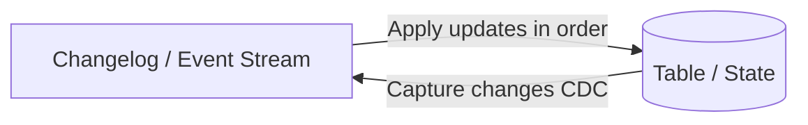
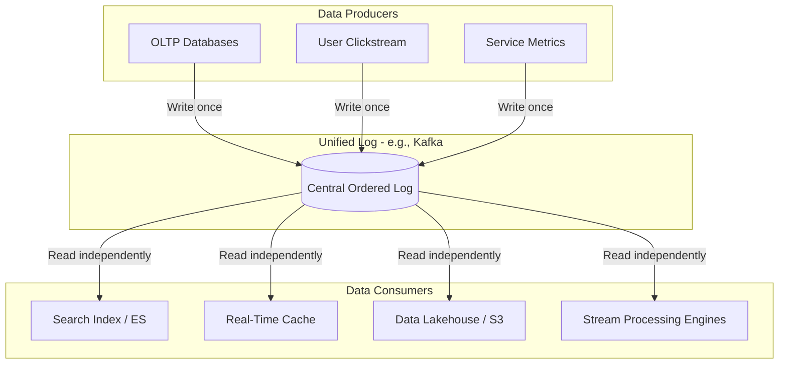

# The Log: What Every Software Engineer Should Know About Real-Time Data's Unifying Abstraction

- **Author:** Jay Kreps (LinkedIn / Confluent)
- **Published:** December 16, 2013
- **Context:** Design philosophy behind Apache Kafka, LinkedIn's data infrastructure, and modern distributed stream processing.
- **Core Thesis:** The log is an append-only, totally ordered data abstraction that serves as the universal backbone for storage systems, distributed consensus, data integration, and stream processing.

---

## 1. What is a Log?

### Definition
A log is an append-only, totally ordered sequence of records ordered by time.
- Writes append strictly to the end.
- Reads proceed sequentially from left to right (oldest to newest).
- Each entry is assigned a monotonically increasing, unique sequential log entry number (offset).

```text
+---+---+---+---+---+---+---+---+---+---+----+----+----+
| 0 | 1 | 2 | 3 | 4 | 5 | 6 | 7 | 8 | 9 | 10 | 11 | 12 | ... Appends ->
+---+---+---+---+---+---+---+---+---+---+----+----+----+
  ^                                                 ^
Oldest Record                                   Next Record
```

### Logical Time vs. Physical Time
- The log entry number acts as a logical timestamp.
- **Crucial Advantage:** It completely decouples ordering from physical wall-clock time, eliminating clock skew and synchronization issues across distributed nodes.

### Data Logs vs. Application Logging
- **Application Logging (`log4j`, `syslog`):** Degenerative, unstructured text streams meant primarily for human eyes during debugging.
- **Data Logs / Journals:** Structured, binary, machine-readable records designed for programmatic throughput, state machine transitions, and replayability.

---

## 2. Logs in Databases & Distributed Systems

### Write-Ahead Logging (WAL)
In traditional databases (e.g., System R, PostgreSQL, MySQL), the log was historically an ACID implementation detail.
- Changes are written to the append-only log on disk *before* updating complex data structures (B-Trees, inverted indexes).
- **Duality:** The log is the definitive record of what happened; the tables and indexes are transient, derived projections of the log.
- In the event of a crash, the log is replayed to reconstruct the correct state of indexes and tables.

### State Machine Replication Principle
> "If two identical, deterministic processes begin in the same state and get the same inputs in the same order, they will produce the same output and end in the same state."

- **Distributed Consensus (Paxos, Raft, Zab):** These algorithms are often taught as abstract voting protocols, but their primary practical use is maintaining consensus on the *next value to append to a shared log*.
- **Primary-Backup Replication:** The leader executes requests, logs the resulting state mutations, and replicas replicate and execute that exact log to stay in sync.

---

## 3. Table-Log Duality (The Yin-Yang of Data)

A fundamental concept uniting databases and stream processing:

| Perspective | Abstraction | Nature | Analogy |
| :--- | :--- | :--- | :--- |
| **Log** | Stream of events / mutations | Data in motion (history) | List of bank debits & credits |
| **Table** | Materialized view / state | Data at rest (snapshot) | Current bank account balance |



- **Log $\rightarrow$ Table:** Applying a changelog sequentially produces the current state.
- **Table $\rightarrow$ Log:** Capturing every insert, update, and delete on a table yields a Change Data Capture (CDC) stream.
- **Version Control Analogy:** Git commits are the log; your checked-out working directory is the table.

---

## 4. Data Integration: Solving the $O(N^2)$ Pipeline Problem

### The Trap: Point-to-Point Pipelines
As organizations adopt specialized data systems (OLAP, search engines, caches, Hadoop/lakehouses, key-value stores), connecting each source directly to each sink creates $O(N^2)$ fragile pipelines:

```text
[RDBMS] -------> [Elasticsearch]
   |    \      /        |
   |     \    /         |
   v      v  v          v
[Cache]  [Hadoop] <--> [Data Warehouse]
```

### The Solution: The Unified Central Log
Decouple producers from consumers entirely using a centralized, ordered, persistent log:



### Key Architectural Benefits
1. **Decoupled Rates:** Real-time search indexing can consume records within milliseconds, while batch jobs (Hadoop/Snowflake) ingest hourly, without impacting each other or the source systems.
2. **Organizational Scalability:** The publishing team only owns formatting and producing a clean, canonical event feed to the log. Destination systems consume independently without requiring bespoke upstream changes.
3. **Buffering & Isolation:** If a downstream consumer crashes or falls behind, the log buffers the data safely on disk, avoiding cascading backpressure across upstream production services.

---

## 5. What Makes a Log Scalable? (Kafka's Design Principles)

Traditional message brokers (JMS, AMQP) struggle with multi-gigabyte throughput because they track per-consumer acknowledgments in memory and delete messages immediately upon delivery. 

Kafka achieved planetary scale by enforcing three engineering primitives:

1. **Partitioning:**
   - A single topic is split across multiple independent logs (partitions).
   - **Ordering Guarantee:** Total ordering is strictly guaranteed *within a partition*, not across partitions. Keys (e.g., `user_id`) route related events to the same partition to maintain causal ordering.
2. **Linear Disk I/O & Batching:**
   - Sequential disk access is orders of magnitude faster than random RAM access.
   - Small writes and reads are grouped into contiguous chunks across client buffers, disk flush operations, and network sockets.
3. **Zero-Copy Data Transfer:**
   - Data is stored in the same binary format on disk as it is transmitted over the wire.
   - Leverages OS-level `sendfile()` system calls to transfer data directly from the pagecache to the network socket without copying bytes into application memory.

---

## 6. Stream Processing & Stateful Computations

### Redefining Stream Processing
Stream processing is **continuous data processing**—a generalization of batch processing that includes logical time and does not wait for a static, finite dataset to finish.

```text
Batch Processing:   Dataset = Bounded Chunk (Static Snapshot)
Stream Processing:  Dataset = Unbounded Sequence over Time (Continuous)
```

### Solving Fault-Tolerant State
Real-world stream processing is rarely stateless; it requires aggregations, joins, and sliding time-windows.
- **Anti-Pattern:** Querying a remote database for every streaming event destroys throughput with network round-trips.
- **The Pattern:** Maintain local, embedded state stores (e.g., RocksDB, LevelDB) co-partitioned with the input stream.
- **Fault Tolerance via Changelog:** Every write to the local state engine is asynchronously mirrored to a dedicated Kafka changelog. If the container crashes, a new instance spins up, replays the changelog, reconstructs the local state table, and resumes processing.

### Log Compaction
To prevent an infinite log of keyed updates from consuming all storage, Kafka uses **log compaction**:
- For event streams (clicks, logs): Retain based on time (e.g., 7 days) or size.
- For state changes (customer records): Kafka deletes older records that share the same key, preserving only the most recent state value per key.
- Compaction allows the log to serve as a perpetual, minimal-footprint backup of a database table.

```text
Before Compaction: [K1:v1] [K2:v2] [K1:v3] [K3:v4] [K2:v5]
After Compaction:  [K1:v3] [K3:v4] [K2:v5]
```

---

## 7. The "Unbundled Database" Vision

Kreps proposes that modern enterprise architecture is essentially an "unbundled" distributed database:

```text
+--------------------------------------------------------+
|                 Unbundled Architecture                 |
+--------------------------------------------------------+
| Commit Log (WAL)   --> Apache Kafka / Distributed Log  |
| Materialized Views --> Elasticsearch, Redis, Snowflake |
| Triggers / Views   --> Flink, Samza, Spark Streaming   |
+--------------------------------------------------------+
```

By decoupling storage into an append-only log of immutable records and query-specific serving layers, teams avoid the architectural constraint of forcing all read, write, and analytical patterns into a single monolithic engine.